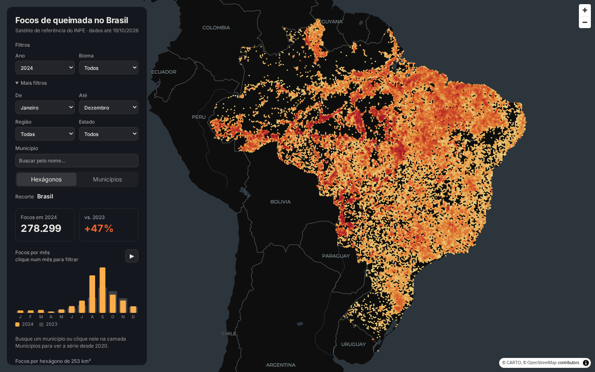

# Monitor de Queimadas — Brasil

Pipeline ELT que coleta todo dia os **focos de calor do INPE**, descobre em qual município cada foco caiu com um **spatial join no PostGIS**, transforma com dbt e publica um **mapa interativo** no GitHub Pages.

**🔥 Mapa:** https://luissfellipe.github.io/queimadas-br/ · **📚 Documentação do dbt:** https://luissfellipe.github.io/queimadas-br/dbt/



**Pergunta:** onde e quando o Brasil queima, e como cada ano se compara ao anterior, por bioma, estado e município?

## Arquitetura

```
INPE (CSVs anuais e mensais) ──► ingest_focos.py ──┐
IBGE (API de malhas, GeoJSON) ──► ingest_malhas.py ┴─► PostGIS (raw) ──► dbt ──► export_site.py ──► site estático
                                                                        staging     JSON por ano       MapLibre + deck.gl
                                                                        intermediate                   (GitHub Pages)
                                                                        marts
                        GitHub Actions: todo dia, do zero, com testes antes de publicar
```

| Camada | Objeto | Descrição |
|---|---|---|
| raw | `raw.focos` | Um foco por linha, chave `foco_id` (UUID do INPE) |
| raw | `raw.municipios` | 5.570 polígonos municipais do IBGE (SIRGAS 2000) |
| raw | `raw.arquivos_carregados` | Arquivo do INPE e data de modificação dele no servidor |
| staging | `stg_inpe__focos`, `stg_ibge__municipios` | Tipagem, data em horário de Brasília, "sem dado" do INPE vira nulo |
| intermediate | `int_municipios__subdivididos` | Polígonos quebrados em pedaços de até 128 vértices, com índice GiST |
| intermediate | `int_focos__geolocalizados` | Cada foco com o município resolvido pela geometria |
| marts | `dim_municipios` | Município, UF, região, área |
| marts | `fct_focos_diarios_municipio` | Focos por dia, município e bioma |
| marts | `fct_focos_bioma_mensal` | Focos por mês e bioma, com o mesmo mês do ano anterior |

## O que os dados mostram

Satélite de referência, de 2020 a outubro de 2026:

| ano | focos |
|---|---|
| 2020 | 222.797 |
| 2021 | 184.081 |
| 2022 | 200.763 |
| 2023 | 189.901 |
| **2024** | **278.299** |
| 2025 | 136.393 |

- **2024 foi o pior ano da série**, e **setembro de 2024** teve 83.154 focos, o pior mês. O segundo pior foi setembro de 2020, com 69.329.
- **O Pantanal teve 14.498 focos em 2024 e 724 em 2025**, uma queda de 95%. A Amazônia caiu de 140.346 para 43.131.
- **Os municípios com mais focos em 2024** foram São Félix do Xingu (PA), com 7.355, Altamira (PA), com 5.995, e Corumbá (MS), com 5.365.

## Decisões técnicas

- **Só o satélite de referência (AQUA_M-T).** Cada satélite novo que entra em operação aumenta a contagem total, então somar todos os satélites mistura mudança de cobertura com mudança no fogo. O INPE usa um único satélite para comparar anos, e este projeto faz o mesmo.
- **Duas fontes com schemas diferentes.** Anos fechados vêm do arquivo anual de referência, que **não traz código IBGE nem coluna de satélite**. O ano corrente vem do mensal, filtrado por `AQUA_M-T`. Antes de usar os dois juntos, conferi que os dois concordam: em jan/2025, os 3.137 focos são os mesmos, com os mesmos IDs e horários.
- **Carga diária sem arquivo diário.** O INPE regrava o mensal do mês corrente todo dia. A ingestão lê a data de modificação na listagem do servidor e só baixa o arquivo que mudou. Cada arquivo substitui por inteiro o que ele mesmo carregou antes, então um foco removido numa revisão do INPE também some daqui.
- **Município pela geometria, não pelo nome.** Como o anual não tem código IBGE, cada foco passa por `ST_Intersects` contra a malha municipal. O join direto passou de 10 minutos sem terminar. Com `ST_Subdivide` (pedaços de até 128 vértices) e índice GiST, leva **30 s para 1,3 milhão de focos**. Os 64 focos que caem fora da malha, no litoral ou na foz de rios, ficam com o município mais próximo, a até 10 km.
- **Um teste vigia o spatial join.** Onde o INPE informa o código IBGE, o município achado pela geometria tem de concordar em pelo menos 98% dos focos. Hoje concorda em **99,44%**, e a diferença que sobra é de focos sobre divisas.
- **Hexágonos H3 calculados no navegador.** Com uma resolução fixa, o hexágono que resume o país cobre vários municípios quando se aproxima uma cidade. O site recebe os focos (coordenada, dia, bioma e município) e agrupa na resolução do zoom: 253 km², 36 km² e 5 km². A partir do zoom 8, cada foco vira um ponto de 1 km, o tamanho do pixel do sensor.
- **Mês em andamento fora da comparação.** Comparar outubro até o dia 19 com o outubro inteiro do ano anterior mostraria uma queda que não existe. O mês parcial aparece no total, mas não entra na variação.
- **Pipeline do zero a cada execução.** O GitHub Actions sobe um PostGIS vazio e refaz toda a carga histórica em cerca de 2,5 min. O resultado não depende de estado guardado em lugar nenhum, e se um teste do dbt falhar, nada é publicado.

## Como rodar

Requisitos: Docker e [uv](https://docs.astral.sh/uv/).

```bash
cp .env.example .env
uv sync
make pipeline        # sobe o PostGIS, ingere, roda dbt build (modelos + testes) e exporta o site
make site            # serve o mapa em http://localhost:8000
```

Outros alvos: `make ingest`, `make transform`, `make export`, `make docs` e `make down`.

## Fontes

- Focos de calor: [INPE, Programa Queimadas](https://terrabrasilis.dpi.inpe.br/queimadas/portal/) (`dataserver-coids.inpe.br/queimadas/queimadas/focos/csv/`)
- Malha municipal: [API de malhas do IBGE](https://servicodados.ibge.gov.br/api/docs/malhas?versao=3)
- Mapa base: © [CARTO](https://carto.com/), © [OpenStreetMap](https://www.openstreetmap.org/copyright) contributors
